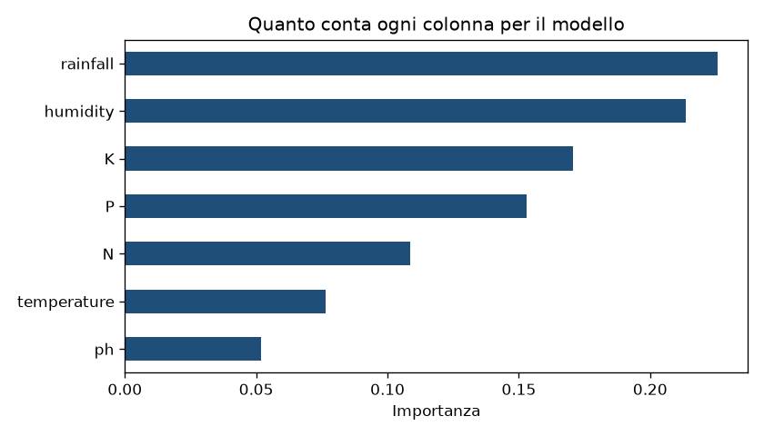

# 🌱 Crop Advisor

Consiglia la coltura più adatta a un terreno partendo da 7 valori: azoto, fosforo, potassio, temperatura, umidità, pH e pioggia. Un modello di machine learning sceglie la coltura, un LLM (Google Gemini) spiega la scelta in italiano dentro un'app web.

**Stack:** Python · pandas · scikit-learn · PyTorch · Streamlit · Google Gemini API

## Risultati

Tutti i modelli usano lo stesso split stratificato: 70% train, 15% validation, 15% test. I modelli si confrontano sul validation; il test viene usato una volta sola, per il modello scelto.

| Modello                                     | Validation | Test      |
| ------------------------------------------- | ---------- | --------- |
| Albero decisionale (profondità 12)          | 98,2%      | —         |
| Random Forest (100 alberi)                  | 99,1%      | **99,7%** |
| Rete neurale MLP (early stopping, epoca 68) | 99,7%      | —         |

La rete supera la foresta di 2 righe su 330 sul validation: è un pareggio tecnico. Ho scelto la **Random Forest** perché è più semplice da usare e mantenere: non richiede normalizzazione né la scelta del numero di epoche.



Pioggia e umidità sono le variabili più importanti: l'acqua è la prima cosa che distingue le colture. Il pH conta poco perché quasi tutte le colture del dataset crescono a pH simile.

## Come funziona

1. **`src/dati.py`** carica il dataset e lo divide. Tutti gli script usano la stessa funzione, così il confronto tra modelli è equo e non c'è data leakage.
2. **`src/allena.py`** confronta albero decisionale e Random Forest sul validation, valuta il migliore sul test e lo salva in `models/`.
3. **`src/rete.py`** allena una rete neurale in PyTorch (7 → 64 → 32 → 22) con normalizzazione ed early stopping.
4. **`src/app.py`** è l'app Streamlit: carica il modello salvato, mostra le 3 colture più probabili e, su richiesta, chiede a Gemini di spiegare la previsione.

**Il modello decide, l'LLM spiega.** La Random Forest è misurata e affidabile sui numeri; Gemini è bravo a spiegare ma può inventare. Per questo riceve dati strutturati e regole precise nel prompt (ruolo, compito, lunghezza, "non inventare dati").

## Come eseguirlo

```bash
python -m venv .venv
source .venv/bin/activate
pip install -r requirements.txt
```

Scarica [Crop Recommendation Dataset](https://www.kaggle.com/datasets/atharvaingle/crop-recommendation-dataset) da Kaggle e metti `Crop_recommendation.csv` nella cartella `data/`. Poi:

```bash
python src/allena.py      # allena, valuta e salva il modello
python src/rete.py        # (facoltativo) la rete neurale

export GEMINI_API_KEY="la-tua-chiave"   # chiave gratuita su aistudio.google.com
streamlit run src/app.py
```

## Limiti

- **Il dataset è piccolo e "pulito"** (2.200 righe, 100 per coltura, nessun valore mancante). Su dati reali di un'azienda agricola l'accuratezza sarebbe più bassa e servirebbe più lavoro di pulizia.
- **Il modello risponde sempre**, anche per terreni mai visti. Con un terreno da deserto (44 °C, pioggia e umidità al minimo) consiglia il melone con circa il 35% di probabilità: per questo l'app mostra un avviso quando la probabilità è sotto il 50%.
- **Gemini può aggiungere interpretazioni sue**, anche se il prompt chiede di non inventare: la decisione resta sempre del modello di machine learning.
